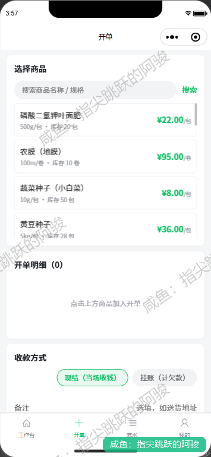
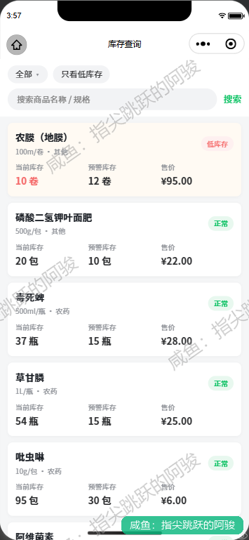
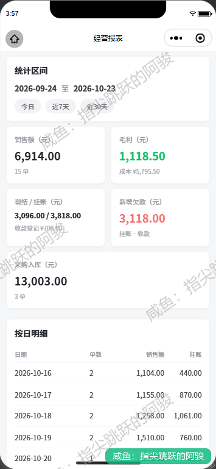
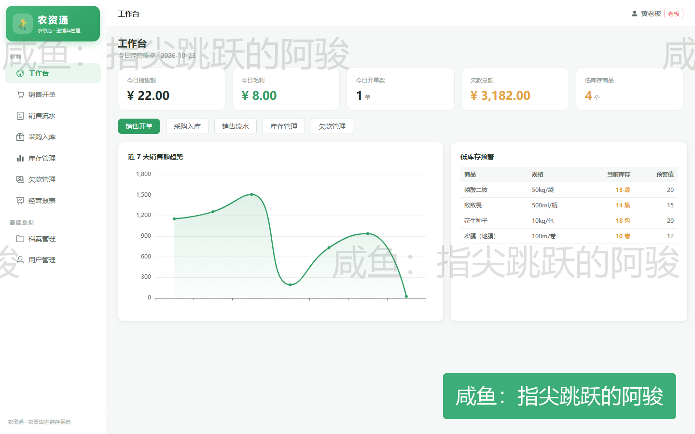
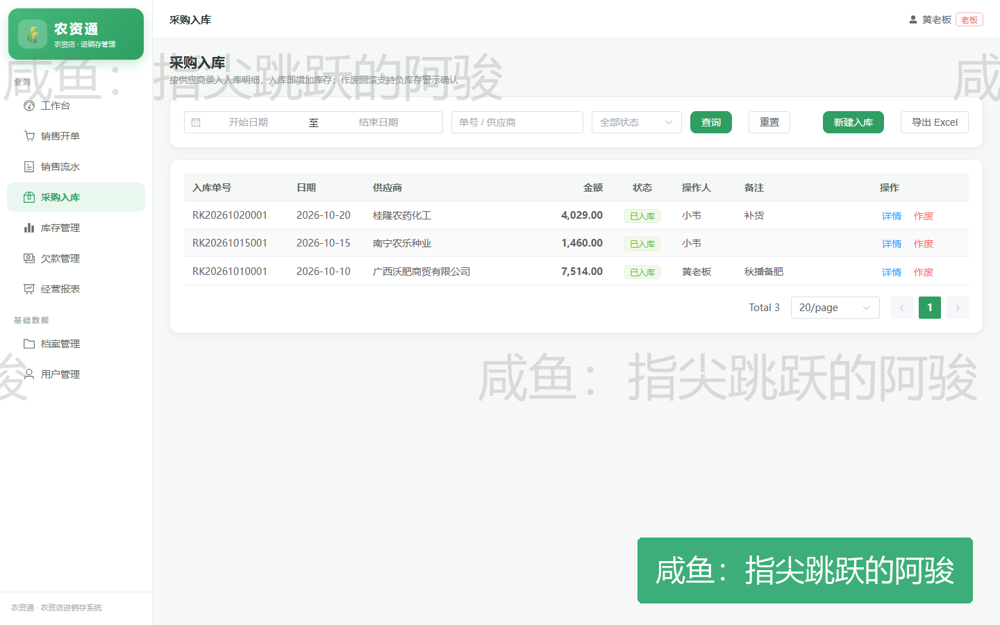
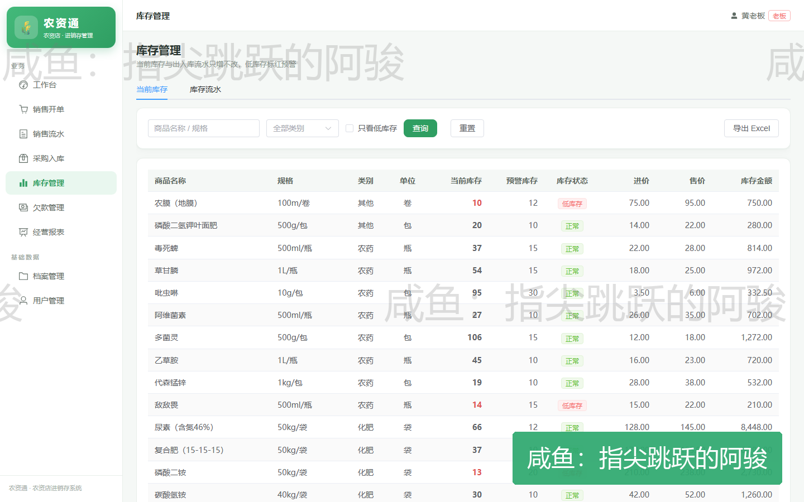

# 农资通 · 农资门店进销存记账系统

> 面向乡镇农资门店（种子 / 化肥 / 农药）的一体化进销存记账系统：小程序开单 + PC 管理后台 + Spring Boot 后端，覆盖「销售开单 → 采购入库 → 库存 → 欠款 → 经营报表」完整链路。

## 界面预览

**小程序端（门店开单）**

| 开单 | 库存查询 | 经营报表 |
|---|---|---|
|  |  |  |

**PC 管理后台**

| 工作台 | 采购入库 | 库存管理 |
|---|---|---|
|  |  |  |

## 解决什么问题

乡镇农资门店的特点：**赊销为主、批次批次保质期、旺季忙到没空记账**。

- 柜台开单快 → 小程序按「商品 → 数量单价 → 自动算金额」开单，老客户一键带出
- 进销存一体 → 采购入库自动加库存，销售自动扣减，库存低于阈值预警
- 赊销对账难 → 欠款按客户聚合，谁欠多少、欠了哪些单清清楚楚
- 老板看趋势 → 经营报表按日/月汇总销售额、毛利与欠款，支持 Excel 导出

## 技术架构

```
miniapp（uni-app + Vue3 + TS）    门店现场开单 / 查库存
admin（Vue3 + Element Plus）      老板进销存与报表
        │                            │
        └──────────┬─────────────────┘
                   ▼
server（Spring Boot 3 + MyBatis-Plus + JWT）
                   │
                   ▼
              MySQL（sql/nongzitong.sql 一键建库）
```

| 模块 | 技术栈 | 说明 |
|---|---|---|
| `miniapp` | uni-app、Vue 3、TypeScript、Vite | 微信小程序端：开单 / 流水 / 库存查询 / 欠款 / 报表 |
| `admin` | Vue 3、Element Plus、Pinia、ECharts | PC 管理后台：工作台 / 销售开单 / 采购入库 / 库存 / 欠款 / 报表 / 档案 / 用户 |
| `server` | Spring Boot、MyBatis-Plus、JWT、MySQL | 单体后端，`NCT_*` 环境变量覆盖配置，本地与云上一套代码 |
| `deploy` | Docker Compose、Nginx | 云端一键部署：MySQL + 后端 + 前端静态托管 |
| `sql` | MySQL | 建库脚本 + 演示数据 |

## 快速开始

```bash
# 1. 数据库
mysql -uroot -p < sql/nongzitong.sql

# 2. 后端（默认连 localhost:3306/nongzitong，账号 root/123456，可用 NCT_* 环境变量覆盖）
cd server && mvn spring-boot:run

# 3. PC 管理后台
cd admin && npm install && npm run dev

# 4. 小程序（HBuilderX 或 CLI）
cd miniapp && npm install && npm run dev:mp-weixin
```

## 说明

- 仓库内数据均为**演示数据**（商品、客户、手机号皆为虚构），不含任何真实客户信息
- 项目由本人独立完成（需求、设计、前后端开发、部署）
